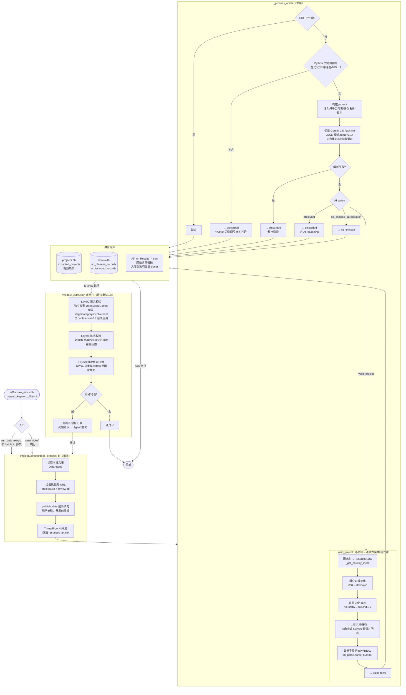

# S01b 新闻筛选与结构化提取 — 逻辑流程图

> 源码：`src/s01b_project_extractor/tools/project_extractor_tool.py`（核心）、`main.py`（入口）、`guardrails/`（质量校验）

## 总览：三道筛子 + 一道质量门

S01b 把 s01a 爬来的新闻逐条「过筛 → AI 结构化 → 分三类入库」，crew 路径额外再过一道 guardrail 质量门。

## 关键设计点

| 环节 | 机制 | 目的 |
|------|------|------|
| 增量去重 | 启动时载入 projects.db+review.db 已处理 URL，并发内 `with _lock` 原子占位 | 跨批/并发不重复调 API |
| Python 预筛 | 正文必须含能源关键词才进 AI | 省 Gemini 调用 |
| 日期前向填充 | 并发前顺序补空 publish_date | 闭包并发无法保证顺序 |
| AI 三分类 | `status` = valid / no_chinese / irrelevant | 一次调用同时完成筛选+结构化 |
| Python 后处理 | 央企判定、中英名、ISO/BRI/LDC、数值解析都在代码端 | 确定性，不靠 LLM |
| 质量门三层 | 语义(模型)→格式(纯Py)→统计(纯Py) | 仅 crew 路径生效；bulk 路径不过门 |

> ⚠️ 注意：`run_bulk_extract` 直接调 `ProjectExtractorTool._run`，**绕过了 crew 的 guardrail**。只有 `run()`/`crew().kickoff()` 路径才会触发 `validate_extraction` 质量门。
